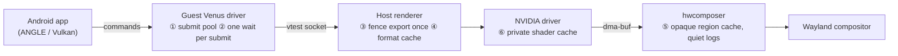

# Waydroid NVIDIA Optimized

A self-contained, performance-focused fork of [Shiro836/waydroid-nvidia](https://github.com/Shiro836/waydroid-nvidia):
GPU-accelerated [Waydroid](https://waydro.id) on NVIDIA cards.

> **Goal:** smoother frames and less CPU overhead in the **Venus** path, without lowering resolution, refresh rate or
> graphics quality. It installs on its own; you do not need the upstream package.

**Contents:** [What this fork does differently](#what-this-fork-does-differently) ·
[Expected performance difference](#expected-performance-difference-theoretical) · [Status](#status) ·
[Install](#install) · [Other driver modes](#other-driver-modes)

## What this fork does differently

The original fork's Venus path forwards each frame like this: the guest Vulkan driver sends commands to the host
renderer over a socket, and hwcomposer hands the finished buffer to your Wayland compositor. This fork leaves the GPU
work unchanged. It removes **CPU work, round trips and lock contention** around each frame.



| # | Change | Original fork | This fork | Why it matters |
|---|---|---|---|---|
| ① | **Submit record pool** (guest Mesa `vn_ring`) | allocates and frees a tracking record for every submit; retiring walks a list that grows with outstanding work | records are reused from a pool, so the cost per submit stays constant | less CPU and allocator churn per submit; no slowdown that builds up in long sessions |
| ② | **One ring wait per submission** (semaphore imports) | a ring round trip for each imported semaphore | one wait for ring consumption per submission, however many semaphores it has | removes (n − 1) guest↔host round trips when a frame waits on several fences |
| ③ | **Fence payload exported once** (host renderer) | every export calls `vkGetFenceFdKHR` under the renderer's sync-thread mutex | exported once, then the kept sync-file is duplicated with `dup()` | an export costs microseconds instead of a driver call behind a contended lock |
| ④ | **Format/modifier cache** (host buffer allocation) | each gralloc allocation asks the driver for format and modifier properties | cached per format after the first query | faster buffer allocation on app start, window resize, rotation and swapchain recreation |
| ⑤ | **hwcomposer opaque region cache + quiet logs** (`hwcomposer/patches/0018`) | creates, sends and destroys a `wl_region` for every layer in every frame; logs every buffer attach | sent only when a layer's opacity or size changes; logs only with `debug.waydroid.hwc_*` | fewer Wayland requests and less compositor region work per frame; no log writes in the present path |
| ⑥ | **Private renderer shader cache** (`wd-venus.service`) | NVIDIA's shared per-user cache, which other desktop apps and games can fill and evict | a dedicated cache under `~/.cache/waydroid-nvidia` | Waydroid's compiled shaders stay cached, so fewer recompile hitches after restarts |
| ⑦ | **Bounded failure handling** | a stalled peer can hang a client forever; EOF could spin | socket I/O fails within 30 s with a named error; fds are never double-closed | a hang becomes a clear error instead of a frozen window |

## Expected performance difference 

### Per-frame overhead (Venus mode, 165 Hz → 6.06 ms frame budget)

| Work per frame | Original fork | This fork | Estimated saving |
|---|---|---|---|
| Opaque region updates, 2–4 visible layers | 4 Wayland requests per layer, every frame | 0 while the layout is unchanged | ~10–40 µs CPU (guest + compositor) |
| Submit bookkeeping, 5–20 submits | malloc/free + list walk per submit | pooled, constant time | ~5–50 µs CPU; more in long sessions |
| Semaphore imports, 2–3 waits | one guest↔host round trip each (~20–60 µs) | one ring wait per submission | ~20–120 µs latency |
| Fence export on the socket path | driver export under a contended mutex (up to ~0.7 ms measured upstream) | `dup()` of the kept payload | up to ~0.1–0.7 ms when the lock is contended |
| **Total, typical frame** | | | **≈ 0.05–0.9 ms less CPU/latency per frame (≈ 1–15 % of the budget)** |

### By scenario

| Scenario | Original fork | This fork (expected) | Main reason |
|---|---|---|---|
| 🖥️ **Launcher / desktop scrolling** (165 Hz) | occasional missed vsync when the CPU is busy | ~2–5 % less CPU per frame; fewer missed frames under background load | ⑤ ① |
| 🎮 **Game, steady gameplay** (60 FPS, many submits) | renderer lock contention adds frame-time spikes | 0.1–1 ms less per frame on contended frames → **lower p95/p99 frame time** (tail latency) | ③ ② ① |
| 🚀 **Second launch of a game** | shaders may be recompiled if the shared cache was evicted | first-use hitches avoided for already-seen shaders (each one can cost tens to hundreds of ms) | ⑥ |
| ↔️ **Window resize / rotation / app start** | a driver property query for every new buffer (3+ buffers per surface) | queries only the first time per format → **shorter resize stutter** | ④ ⑤ |
| ⏱️ **Long sessions** (hours) | submit bookkeeping cost can grow with outstanding work | constant, with no gradual degradation | ① |
| 🧯 **Renderer stall / crash** | the app can freeze indefinitely | clear error within 30 s | ⑦ |

### What this should feel like

Compared with the original fork's Venus mode, this fork should feel **smoother and more consistent**:

- frame times spike less often (better **1 % lows**);
- scrolling and animations hit vsync more reliably when the CPU is busy;
- there are fewer hitches after resizing a window or relaunching a game.

Average FPS in GPU-heavy games stays about the same. The gains are in **consistency**, not peak throughput.

## Status

- Synchronization and fault regression tests pass, and both guest ABIs (x86, x86_64) build.
- Full live gameplay acceptance is **still pending**. Some games (for example Epic Seven) still stutter, and results
  vary by game and system ([measurements](docs/performance-epic7-2026-09-19.md),
  [acceptance criteria](docs/performance-smoothness.md)).
- The optimized Venus binaries (`perf-v1`) are built locally and checksummed, **not CI-attested**.
- Change ⑤ exists in source only. The installed hwcomposer is still upstream's until a new overlay ships.

## Install

**Requirements:**

- an NVIDIA GPU with `nvidia-drm.modeset=1` and a Wayland desktop running on it;
- Waydroid kernel support (binder) on a systemd distribution;
- for Venus mode, the **open** NVIDIA kernel module and driver 580 or newer.

Remove an older `waydroid` or `waydroid-nvidia-bin` package first, because the installer never overwrites files owned
by a distro package. Android apps and data in `/var/lib/waydroid` are kept.

```sh
git clone https://github.com/ErenEksen/waydroid-nvidia-optimized.git && cd waydroid-nvidia-optimized
./install.sh                                # run as your desktop user; it asks for sudo
systemctl --user enable --now wd-venus.service
sudo waydroid-nvidia-setup --mode venus     # add -s GAPPS for Google apps on a fresh install
waydroid session start
```

- Log out and back in once so the `/dev/udmabuf` permission rule takes effect.
- `./install.sh --check` only downloads and verifies; it installs nothing.
- Every binary is pinned by SHA-256 in [`packaging/releases/`](packaging/releases/).
- **Update:** `git pull`, then run `./install.sh` again. Run `sudo waydroid-nvidia-setup` again after every NVIDIA driver
  update.
- **Uninstall:** `sudo /usr/lib/waydroid-nvidia/install.sh --uninstall`.
  `sudo waydroid-nvidia-setup --restore-official-vendor` returns to stock Waydroid. More in
  [installer options](docs/install-manual.md).

## Other driver modes

The install also includes upstream's other two modes, unchanged:

- `nvidia-prolapse`: upstream's default; an open-source NVK-based driver with video decode.
- `glibc-shim`: runs the host's own NVIDIA driver inside Android.

Switch with `sudo waydroid-nvidia-setup --mode <mode>`. GPU and driver compatibility for these modes is documented
upstream. This fork's optimizations ①–④ and ⑥ apply only to Venus mode.

## Development

[Dev workflow](docs/dev-workflow.md) · [building](docs/building.md) · [architecture](docs/architecture.md) ·
[fence design](docs/fence-timeline-design.md) · [troubleshooting](docs/troubleshooting.md) ·
[third-party sources](THIRD_PARTY.md)

## Credits / license

Based on **Shiro836/waydroid-nvidia**, Mesa, virglrenderer and Waydroid. The prebuilt base (vendor image, native
driver bundle, ANGLE, SurfaceFlinger) is upstream's v0.2.0-rc12 build. Our code is [MIT](LICENSE). Patches keep their
upstream licenses. This fork does not maintain or guarantee upstream's benchmark claims.
